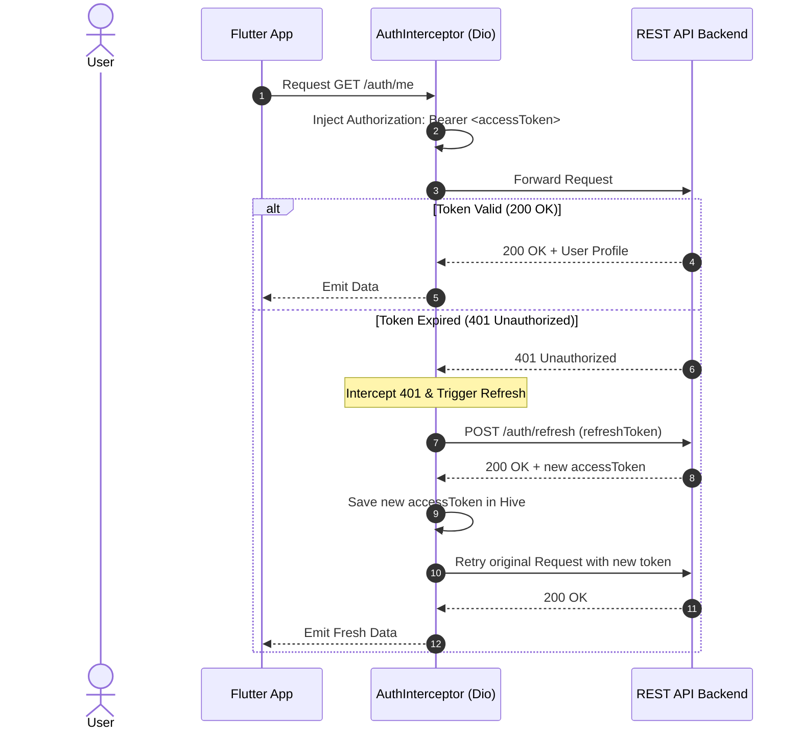

# 📱 Flutter Connected App — Real REST Backend & Offline Persistence

A production-ready Flutter application built with **Clean Architecture / Feature-First** design, connected to a live REST API backend with **JWT Bearer Authentication**, automatic **Token Refresh interceptors**, **Hive local caching**, and **Offline-First fallback** support.

---

## 🌟 Key Features

1. **Authentication (JWT Login, Register, Profile, Logout)**:
   - Real JWT token exchange with `https://dummyjson.com/auth/login`.
   - Bearer token injection on all protected requests.
   - Automatic `401 Unauthorized` token refresh handling via Dio `QueuedInterceptor`.
   - Session persistence in local storage across app restarts.
   - Built-in demo accounts quick-fill buttons for instant testing (`emilys`, `michaelw`).

2. **At Least 3 Live REST Data Screens**:
   - 🛒 **Store Catalog Screen** (`/products`): Multi-category filtering, real-time search, discount badges, ratings, stock counts, and responsive product grid.
   - 💬 **Community Feed Screen** (`/posts`): Social feed with post tags, view counters, interactive like toggles, and expandable comments drawer (`/comments/post/{id}`).
   - 🍳 **Culinary Discovery Screen** (`/recipes`): Filter by meal types (Dinner, Lunch, Dessert, etc.), prep/cook time, calorie count, interactive ingredient checklist, and step-by-step cooking instructions.
   - 🔍 **Product Detail Screen** (`/products/{id}`): Multi-image carousel, specifications, customer reviews, and cart action.
   - 👤 **Profile & Security Inspector**: Live JWT access token viewer, refresh token inspector, Hive cache statistics, and offline simulation toggle.

3. **Offline Mode & Persistence (Hive)**:
   - **Cache-First / Remote-Sync Strategy**: Fetches live data when online, stores in Hive boxes, and seamlessly falls back to cached data during network drops.
   - **Simulate Offline Mode Toggle**: In-app switch inside Profile to test offline caching instantly without disabling device Wi-Fi.
   - **Visual Offline Status Banner**: Informs users when data is served from local cache.

4. **Network & Error Handling**:
   - Custom exception hierarchy (`ServerException`, `AuthException`, `NetworkException`, `CacheException`).
   - Domain failure mapping (`ServerFailure`, `AuthFailure`, `NetworkFailure`, `CacheFailure`).
   - Dedicated `ErrorView` and floating SnackBars with retry actions.

5. **Unit Tests on Repository Layer**:
   - Comprehensive test suites for `AuthRepositoryImpl`, `ProductRepositoryImpl`, `PostRepositoryImpl`, and widget smoke tests using `mocktail` and `flutter_test`.

---

## 🏗️ Architecture Overview

The project is structured according to **Feature-First Clean Architecture**:

```
lib/
├── core/
│   ├── constants/
│   │   └── api_constants.dart          # Base URLs, endpoints, timeouts, cache keys
│   ├── error/
│   │   ├── exceptions.dart             # Data layer exceptions
│   │   └── failures.dart               # Domain layer failures
│   ├── network/
│   │   ├── api_client.dart             # Configured Dio HTTP client
│   │   ├── auth_interceptor.dart       # Bearer token injection & 401 token refresh
│   │   └── network_info.dart           # Connectivity & simulated offline manager
│   ├── storage/
│   │   └── hive_storage.dart           # Hive boxes for tokens, session, and cache
│   ├── theme/
│   │   └── app_theme.dart              # Material 3 light & dark theme styling
│   └── utils/
│       └── result.dart                 # Functional Result<T> (Success/Error) wrapper
├── features/
│   ├── auth/                           # JWT Authentication & User Profile
│   │   ├── data/ (datasources, models, repositories)
│   │   ├── domain/ (entities, repository contracts)
│   │   └── presentation/ (controllers, screens)
│   ├── products/                       # Products Catalog & Details
│   │   ├── data/ (datasources, models, repositories)
│   │   ├── domain/ (entities, repository contracts)
│   │   └── presentation/ (controllers, screens, widgets)
│   ├── posts/                          # Community Feed & Comments
│   │   ├── data/ (datasources, models, repositories)
│   │   ├── domain/ (entities, repository contracts)
│   │   └── presentation/ (controllers, screens)
│   ├── recipes/                        # Culinary Discovery & Details
│   │   ├── data/ (datasources, models, repositories)
│   │   ├── domain/ (entities, repository contracts)
│   │   └── presentation/ (controllers, screens)
│   └── home/
│       └── presentation/screens/main_shell.dart # Bottom navigation bar shell
├── widgets/
│   ├── error_view.dart                 # Reusable error & retry widget
│   ├── loading_indicator.dart          # Loading spinner with status message
│   └── offline_banner.dart             # Offline warning banner
└── main.dart                           # App bootstrap & MultiProvider DI
```

---

## 🌐 APIs Used

This application connects to the live **[DummyJSON REST API](https://dummyjson.com)**:

| Endpoint | Method | Purpose | Auth Required |
| :--- | :--- | :--- | :--- |
| `/auth/login` | `POST` | Authenticate user, receive JWT & Refresh token | No |
| `/auth/refresh` | `POST` | Renew expired access token using refresh token | No |
| `/auth/me` | `GET` | Get current authenticated user profile | Yes (Bearer JWT) |
| `/products` | `GET` | Retrieve paginated products list | No |
| `/products/search?q={query}` | `GET` | Search products | No |
| `/products/category/{cat}` | `GET` | Filter products by category | No |
| `/posts` | `GET` | Retrieve community posts | No |
| `/posts/tag/{tag}` | `GET` | Filter posts by hashtag | No |
| `/comments/post/{id}` | `GET` | Retrieve comments for specific post | No |
| `/recipes` | `GET` | Retrieve culinary recipes | No |
| `/recipes/meal-type/{type}` | `GET` | Filter recipes by meal category | No |

---

## 🔐 Dio Interceptor & Refresh Token Flow



---

## 💾 Caching & Offline Strategy

1. **Hive Boxes**: High-performance NoSQL key-value storage initializes on startup (`auth_box`, `products_box`, `posts_box`, `recipes_box`, `app_settings_box`).
2. **Online Mode**: When `networkInfo.isConnected == true`, repositories fetch data from the REST API, asynchronously update local Hive boxes, and emit fresh data.
3. **Offline Mode**: If the device loses internet connection (or "Simulate Offline Mode" is toggled in Profile), repositories load data directly from Hive cache.
4. **Offline Search**: Search and category filtering are executed on cached datasets when offline.

---

## 🚀 Getting Started & Configuration

### Prerequisites
- **Flutter SDK**: `>=3.0.0 <4.0.0`
- **Dart SDK**: `^3.10.3`
- Compatible with **Android**, **iOS**, **Web**, **macOS**, **Windows**, and **Linux**.

### Installation & Run

1. Clone this repository:
   ```bash
   git clone <repo-url>
   cd projet4
   ```

2. Install dependencies:
   ```bash
   flutter pub get
   ```

3. Run the application:
   ```bash
   flutter run
   ```

### Demo Accounts for Instant Login

| Username | Password | Role |
| :--- | :--- | :--- |
| `emilys` | `emilyspass` | Standard User |
| `michaelw` | `michaelwpass` | Standard User |

*(Quick-fill chips are available directly on the login screen for 1-tap testing).*

---

## 🧪 Running Unit Tests

Run the complete suite of repository and widget tests:

```bash
flutter test
```

Run specific test files:
```bash
# Auth Repository Tests (Login, Token caching, Logout, Offline session)
flutter test test/features/auth/data/repositories/auth_repository_impl_test.dart

# Product Repository Tests (Remote fetch, Hive caching, Offline fallback)
flutter test test/features/products/data/repositories/product_repository_impl_test.dart

# Post Repository Tests (Remote feed, Comments, Offline tags)
flutter test test/features/posts/data/repositories/post_repository_impl_test.dart
```

Run static analysis:
```bash
flutter analyze
```

---

## 📄 License
MIT License
# ffsc-project4-food-app-home
